# Modelos y reloj corregidos

25 comprobaciones de motor y 119 de funciones, sin fallos, con 6 MB sin swap en DOSBox. Véanse MANIFEST.json y RESULT.TXT; la revisión Linux con sanitizadores también pasó. Los modelos no se consideran equivalentes en todos sus detalles al original.

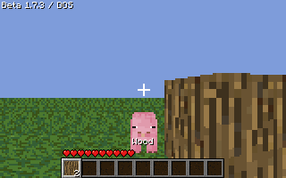

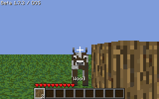

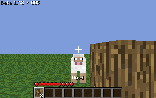

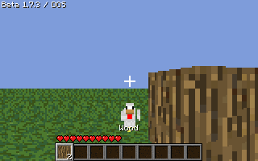

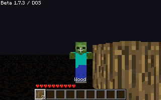

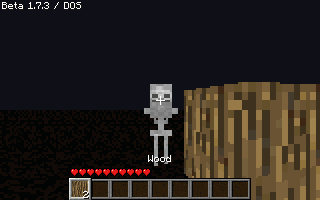

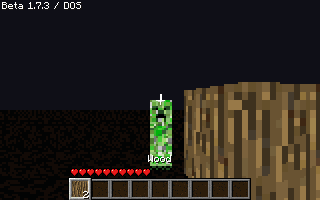

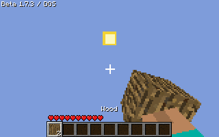

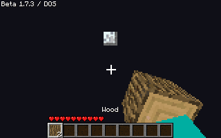

## Pose de la mano

Solo se ajustó la pose de primera persona. Se conserva al mirar arriba; la prueba compara su región, excluyendo el cielo. Capturas producidas por el ejecutable:

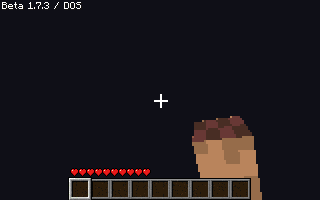

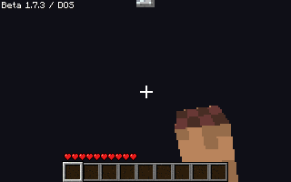

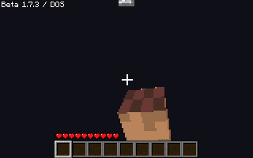
