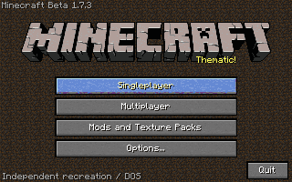
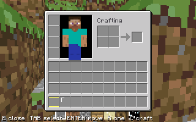
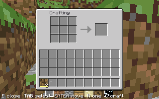
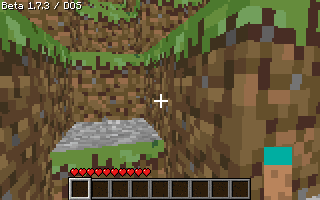
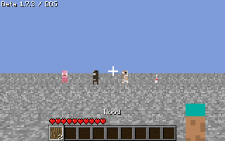

# Validación de la interfaz Beta y supervivencia básica

El EXE identificado en `MANIFEST.json` se ejecutó en DOSBox 0.74-3, CPU `pentium_slow`, núcleo normal, 50.000 ciclos configurados, VGA y **6 MB de memoria total emulada**. CWSDPMI se cargó con `-p -s-`, sin intercambio. No se deduce el cumplimiento de RAM solo del tamaño del archivo.

- `RESULT.TXT`: **25 comprobaciones del motor y 93 de funciones nuevas, 0 fallos**, catálogo de 151 recetas y memoria física disponible observada por DPMI.
- Las pruebas cubren patrones 2×2/3×3, reflejo/desplazamiento, metadatos de cacao/carbón, sopa vertical antigua, recetas sin forma, cantidades, inventario lleno, cursor de resultado, retorno de cubos de la tarta, límites de pila, vida/comida/muerte, requisitos de logros, corrupción de perfil, minado/colocación, interacciones con animales, creación/carga/renombrado/borrado de mundo, pantallas y opciones.
- `SMOKE.TXT`: modo VGA 19 decimal (13h), IRQ de teclado instalada, cuatro cuadros y **0 diferencias** al leer 64.000 bytes de VRAM por cuadro.
- `PACKAGE-CHECK.TXT`: la misma prueba sobre el ZIP extraído, con sus archivos de distribución y sin depender de los PNG o fuentes del repositorio.
- `SANITIZERS.TXT`: la compilación Linux con AddressSanitizer/UndefinedBehaviorSanitizer y la detección de fugas completó las pruebas sin hallazgos. Se ejecutó fuera del aislamiento ptrace, que impide funcionar a LeakSanitizer.
- `SIZE.TXT`: secciones del EXE; no representa el consumo total de DOS, DPMI, pilas y memoria dinámica.

## Fotogramas generados por el ejecutable DOS

Estos PNG son conversiones sin cambios de píxeles de los PPM que escribió el propio programa durante las pruebas. El PPM utiliza la paleta de origen de ocho bits; el DAC VGA utiliza seis bits por canal. No son fotografías de un monitor físico.

Menú:

Inventario con Steve:

Crafteo 3×3:

HUD:

Animales básicos en una escena determinista de prueba:

La prueba de VRAM valida la copia de video. La instalación de la IRQ no prueba pulsaciones físicas de todos los teclados/ratones. El tiempo de cuatro cuadros pertenece al emulador: no es una medición de FPS de un Pentium real. No se ha ejecutado todavía en hardware físico o MS-DOS 6.22 instalado. Las funciones pendientes de `../README.md` siguen pendientes aunque existan recetas o pantallas relacionadas.
